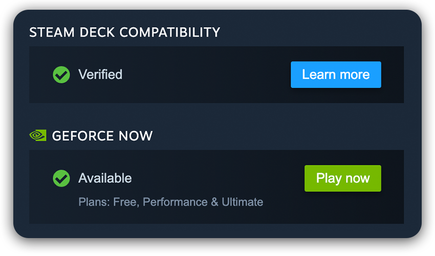
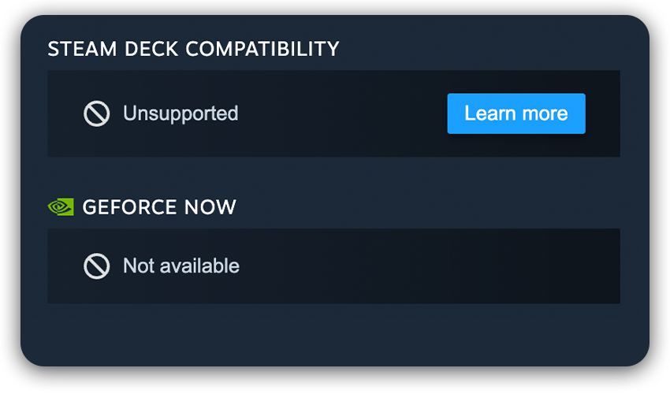

# GeForce NOW on Steam

A userscript for the Steam store. On every game page it adds a **GeForce NOW** section right below *Steam Deck Compatibility*, styled like Steam's own section:

* **Available** or **Not available** on GeForce NOW
* if available, the GeForce NOW plans that include the game (*Free, Performance & Ultimate* or *Performance & Ultimate*)
* a **Play now** button that opens the game on GeForce NOW

  
  

*Left: a game on GeForce NOW. Right: a game that isn't.*

## Install

1. Install a userscript manager: [Tampermonkey](https://www.tampermonkey.net/) or [Violentmonkey](https://violentmonkey.github.io/) (Chrome, Edge, Firefox, Safari).
2. Open **[geforcenow-steam.user.js](https://raw.githubusercontent.com/lcshmn/steam-geforcenow-userscript/main/geforcenow-steam.user.js)**. Your userscript manager shows an install page; confirm it.
3. Open any game on [store.steampowered.com](https://store.steampowered.com/).

There is nothing to configure. The texts follow the store's language (English or German, English for all others). Updates are installed by your userscript manager from this repository.

## How it works

* **Data source.** The list of games comes from NVIDIA's public GeForce NOW catalog, the feed behind NVIDIA's own "supported games" page (`POST https://api-prod.nvidia.com/services/gfngames/v1/gameList`). Every Steam version of a game in that catalog is matched by its Steam app id.
* **Caching.** GeForce NOW adds games once a week, on Thursdays. The script downloads the catalog (about 6,000 games, a few requests) after each Thursday's update (from 18:00 UTC, and once more a day later for late additions) and keeps it in your userscript manager's storage. A store page only does a local lookup. If a download fails, the last list is used.
* **Plans.** NVIDIA's catalog only knows two levels: no requirement (playable on the free plan) and "Premium" (any paid plan, i.e. Performance or Ultimate).
* **Play now** opens `https://play.geforcenow.com/games?game-id=…`, NVIDIA's web link to a game in GeForce NOW.
* **Layout.** The section copies the markup, icons and styling of Steam's Deck section. It uses its own class names, so it doesn't break when Steam renames its generated ones. Steam renders its Deck section after the page has loaded; the GeForce NOW section moves below it once it appears.

## Regions

GeForce NOW's catalog differs slightly between regions (licensing), so the script asks NVIDIA for the catalog of **your Steam store country** (Steam's own `g_strCountryCode`; if that isn't available, the country from your browser language, otherwise US). When the country changes, the catalog is downloaded again.

Limitations:

* The Steam store country is the country of your Steam account's store, which is usually, but not always, where you play.
* In countries where GeForce NOW is run by a partner (GeForce NOW Alliance, e.g. in Japan or Turkey), plans and availability can differ from NVIDIA's catalog.

## Privacy and permissions

The script runs only on `https://store.steampowered.com/app/*` and requests these permissions:

| Permission | Used for |
| --- | --- |
| `GM_xmlhttpRequest`, `@connect api-prod.nvidia.com` | downloading the public catalog from NVIDIA; no other server is contacted |
| `GM_getValue` / `GM_setValue` | caching the catalog (country, time of download, list of games) |
| `unsafeWindow` | reading the store country (`g_strCountryCode`) from the Steam page |

What leaves your browser: once a week, a request to NVIDIA with your **country code** (and, as with any request, your IP address). Requests are sent without cookies. Nothing about your Steam account, the pages you visit or the games you look at is sent anywhere. When you click **Play now**, you go to NVIDIA's site with the game's GeForce NOW id (and `utm_source=steam-userscript`), without a referrer. The script has no analytics, no tracking and no external scripts.

## Development

The script is a single file without build step or dependencies: edit [`geforcenow-steam.user.js`](geforcenow-steam.user.js) and reinstall it, or point your userscript manager at a local copy. Increase `@version` for every release, otherwise userscript managers don't pick up the update, and add an entry to [CHANGELOG.md](CHANGELOG.md).

## Notes

* NVIDIA's catalog API is unofficial and may change without notice.
* "GeForce NOW", "NVIDIA" and the NVIDIA logo are trademarks of NVIDIA Corporation. The NVIDIA logo mark is taken from [Simple Icons](https://simpleicons.org/); the status icons are Steam's. This project is not affiliated with NVIDIA or Valve.

## AI notice

This userscript and its documentation were created with the help of an AI assistant (Claude by Anthropic), under the direction of and reviewed by the maintainer. Please report problems via [issues](https://github.com/lcshmn/steam-geforcenow-userscript/issues).

## License

BSD-3-Clause, see [LICENSE](LICENSE).
